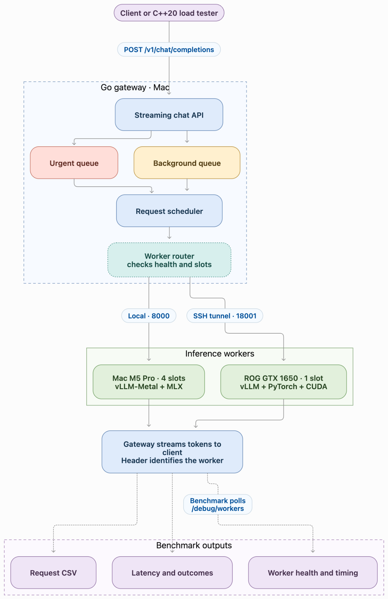

# Distributed LLM Inference Platform

A Go gateway schedules and streams LLM requests across two very different machines: an Apple Silicon Mac and an NVIDIA laptop reached over Wi-Fi. A C++20 load generator measures what a caller experiences, from sending a request to receiving the first generated text and the final token.

The project asks a practical serving question: **when the fast worker is busy, should an urgent request wait, or should the gateway send it to a slower worker that is free?** At light load, the Mac returned the first token faster. Under overload, using both machines reduced rejections. During a live network outage, the gateway continued serving on the Mac and returned the NVIDIA worker to rotation when the connection recovered.

| Experiment | Measured result |
|---|---|
| **Scheduling on one Mac** | Offered **108,000 requests** across 18 runs at 20 requests/s. **107,784 completed** and **216 were rejected**. With priority scheduling and four slots, all **4,500 urgent requests** met the 500 ms first-token target across three seeds. |
| **Routing across two machines** | At 120 offered requests/s, round-robin completed **3,183/3,600** requests versus **3,084/3,600** on the Mac alone. It delivered a first token within 500 ms for **770/900** urgent requests versus **743/900**. |
| **Live disconnect and recovery** | During a 90-second trial, **1,799/1,800** requests completed. One background stream on the disconnected worker was interrupted. **All 450 urgent requests** met the 500 ms target. |

**Stack:** Go · C++20 · libcurl · vLLM · MLX / Metal · PyTorch / CUDA · WSL2

[Architecture](#architecture) · [Benchmark results](#benchmark-results) · [Run locally](#run-locally) · [Reproduce the experiments](#reproduce-the-experiments) · [Source guide](#source-guide)

## Architecture

<p align="center">
  <a href="docs/images/architecture.png"></a>
</p>

**Scheduling chooses which request goes next.** The gateway accepts OpenAI-compatible streaming chat requests. A caller can set `X-Request-Priority: urgent`. Under FIFO, queued requests start in arrival order. Under priority scheduling, a waiting urgent request can go ahead of waiting background work. Active streams keep their slots until completion or disconnect. When the bounded queue fills, the gateway returns HTTP 429. Sustained urgent traffic can increase background wait times.

**Routing chooses where the request runs.** Each worker serves a complete copy of the model under the same API name. The Mac serves a 4-bit MLX checkpoint. The ROG serves the model in FP16 on a GTX 1650 with 4 GB of VRAM. Direct measurements include differences in hardware, runtime, precision, and the ROG’s network path.

| Mode | Decision |
|---|---|
| `primary-only` | Use the Mac. Provides a single-worker baseline. |
| `round-robin` | Rotate among healthy workers with an available slot. A busy ROG is skipped, so the split can be uneven. |
| `load-aware` | Estimate time until a slot opens plus time to first token for that request class. The router can wait for the Mac when that is the faster prediction. Estimates account for active work and queued requests and can adapt as requests complete. |

**Failure handling preserves the stream boundary.** With another eligible worker, a connection failure or upstream 500, 502, 503, or 504 can trigger one retry before the gateway sends a response to the client. Once tokens have reached the client, a broken stream ends as interrupted. Health probes bring recovered workers back into rotation. The response header `X-Inference-Worker` identifies the serving worker. A separate primary/backup mode is available with `-worker` and `-backup-worker` when `-route` is omitted.

The custom components are the gateway, scheduler, router, load generator, and experiment scripts. The vLLM backends own model execution, batching, and KV-cache management. Gateway slots control how many requests can reach each worker concurrently.

## Benchmark results

### Scheduling on the Mac

Each run offered 6,000 requests at 20 requests/s. The matrix crossed two queue policies, three slot counts, and three seeds. Each seed replayed the same workload across configurations. Warm-ups were excluded. Urgent requests requested up to 4 output tokens and background requests up to 10.

| Queue policy | Slots | Urgent p95 first-token latency, seeds 42 / 43 / 44 | Urgent within 500 ms |
|---|---:|---|---:|
| FIFO | 1 | 8,609 / 14.5 / 14.1 ms | 4,155/4,500 |
| FIFO | 2 | 23.9 / 14.0 / 14.0 ms | 4,500/4,500 |
| FIFO | 4 | 18.7 / 13.4 / 14.6 ms | 4,500/4,500 |
| Priority | 1 | 15.0 / 13.2 / 46.1 ms | 4,500/4,500 |
| Priority | 2 | 16.7 / 13.4 / 14.0 ms | 4,500/4,500 |
| Priority | 4 | 13.6 / 13.7 / 14.2 ms | 4,500/4,500 |

All 216 rejections occurred in the first FIFO one-slot trial. Its slowdown began during the run and did not recur in either repeat. The cause remains open. The full matrix includes that trial. Worker metrics sampled every 500 ms observed at most two simultaneous running requests and little KV-cache use. These short generations establish latency at the tested arrival rate. Measuring batching gains or cache pressure requires a workload with more sustained overlap.

### Routing between the Mac and the ROG

At one request/s, median urgent first-token latency was **30.2 ms on the Mac** and **173.3 ms on the ROG** through the tunnel. Median background completion time was **63.6 ms** and **476.1 ms**, respectively. Each worker received the same 30 measured requests after warm-up. These measurements motivated a router that can wait briefly for a Mac slot.

At **20 requests/s**, Mac-only recorded **17.5 ms** urgent p95. Load-aware kept all 1,200 requests on the Mac and recorded **20.3 ms**. Round-robin sent 145 requests to the ROG and recorded **153.3 ms**. All three modes completed the workload. At **60 requests/s**, each mode again completed all 1,200 requests, with all urgent requests meeting the target. These two rates were tested with one seed each.

At **120 requests/s**, queues filled. The table combines three seeds, each offering 1,200 requests per mode, including 300 urgent requests.

| Mode | Completed / offered | Rejected | Urgent within 500 ms | Completed by ROG |
|---|---:|---:|---:|---:|
| Mac-only | 3,084/3,600 | 516 | 743/900 (82.6%) | 0 |
| Round-robin | **3,183/3,600** | **417** | **770/900 (85.6%)** | 88 |
| Load-aware | 3,130/3,600 | 470 | 752/900 (83.6%) | 74 |

Round-robin completed the most requests in each overload trial. Load-aware used the ROG during overload and achieved the best urgent result on one of the three seeds. For this hardware and traffic mix, the simpler policy produced the best aggregate overload result. The experiment leaves open the exact load at which using the second worker starts to pay off.

### Failure and recovery

- **Primary shutdown.** At one request/s, a shutdown-time HTTP 500 initially reached the client. After adding a single pre-stream retry for that status, three live 30-request trials completed **90/90** requests. Time from the shutdown signal to the first backup content was **460–483 ms**. This measurement includes request arrival timing.
- **Tunnel disconnect under traffic.** Round-robin received 1,800 requests over 90 seconds. Between the samples at +27 s and +59 s, the Mac dispatch count increased by **644** while the ROG count stayed fixed. At +60 s the ROG was healthy and its count increased again. The run recorded **zero rejections**, one interrupted ROG background stream, and **151.4 ms** urgent p95. The one-second samples show the recovery sequence. They give only approximate transition times.

### Reading the metrics


- **Time to first token (TTFT)** runs from client dispatch to the first non-empty content chunk. The initial role-only event is skipped when identifying the first token. p95 is calculated over successful requests.
- **Urgent target attainment** divides successful urgent requests with TTFT within 500 ms by **all offered urgent requests**. Rejections and failures count as misses. This makes the overload comparison meaningful even when successful-request p95 stays low.
- **Completed requests/sec** measures successful completions over the observed workload window. Offered rate is an input, and maximum sustainable capacity is a separate experiment.
- **Open-loop arrivals** follow a seeded schedule independent of earlier responses. The bounded C++ client pool records dispatch lateness and saturation, exposing runs where the client fell behind.
- The benchmark records worker attribution, completion status, interruptions, and available worker metrics. Raw CSVs and logs are generated locally under `results/` and are Git-ignored.

## Run locally

### Quick start with the simulator

The simulator exercises routing-independent streaming and queue behavior on a single machine. It produces synthetic token chunks and requires no model download.

Requirements: Go 1.22+, a C++20 compiler, Make, libcurl development files, and the nlohmann JSON headers. On macOS, install the Xcode Command Line Tools and use Homebrew for missing packages.

```bash
git clone https://github.com/kishoreqwerty/distributed-llm-inference-platform.git
cd distributed-llm-inference-platform
brew install go nlohmann-json
make build
make test
```

From the repository root, use three terminals:

| Terminal | Command | Expected behavior |
|---|---|---|
| 1 | `./bin/simulator` | Starts the synthetic worker on port 8000 |
| 2 | `./bin/gateway -policy priority -slots 1` | Starts the gateway on port 8080 |
| 3 | `./scripts/smoke.sh` | Prints streaming chunks followed by `data: [DONE]` |

To send your own request from terminal 3:

```bash
curl -fsS -N http://127.0.0.1:8080/v1/chat/completions \
  -H 'Content-Type: application/json' \
  -H 'X-Request-Priority: urgent' \
  -d '{"model":"Qwen/Qwen2.5-0.5B-Instruct","messages":[{"role":"user","content":"Name one use for a GPU."}],"max_tokens":12,"stream":true}'
```

### Real workers used in the benchmarks

Stop the simulator before starting the Mac model on the same port. The commands below describe the tested setup.

**Mac primary.** The runs used an Apple M5 Pro with 24 GB unified memory and vLLM-Metal 0.33.0.

```bash
brew tap vllm-project/vllm-metal https://github.com/vllm-project/vllm-metal
brew install vllm-project/vllm-metal/vllm-metal
vllm serve mlx-community/Qwen2.5-0.5B-Instruct-4bit \
  --served-model-name Qwen/Qwen2.5-0.5B-Instruct \
  --host 127.0.0.1 --port 8000 --max-model-len 512
```

**NVIDIA worker.** The tested Ubuntu WSL2 environment used Python 3.12, vLLM 0.6.6.post1, PyTorch 2.5.1+cu124, and a GTX 1650 with 4 GB VRAM. With the Windows NVIDIA driver, WSL GPU access, and `uv` already configured, run inside Ubuntu:

```bash
uv venv --python 3.12
source .venv/bin/activate
uv pip install --torch-backend cu124 'torch==2.5.1' 'torchvision==0.20.1' \
  'vllm==0.6.6.post1' 'transformers==4.47.1' 'numpy<2'

vllm serve Qwen/Qwen2.5-0.5B-Instruct \
  --host 127.0.0.1 --port 8000 --dtype half --max-model-len 512 \
  --max-num-seqs 1 --gpu-memory-utilization 0.70 --swap-space 0 --enforce-eager
```

**Connect the machines.** With Remote Login enabled on the Mac for the intended user, verify the ROG model from **Windows PowerShell**, then open the reverse SSH tunnel in that terminal. Substitute your Mac account and Wi-Fi IP.

```powershell
curl.exe -fsS http://127.0.0.1:8000/v1/models
ssh -NT -o ExitOnForwardFailure=yes -R 127.0.0.1:18001:127.0.0.1:8000 MAC_USER@MAC_WIFI_IP
```

Leave the tunnel open. From the Mac, port 8000 reaches the local worker and port 18001 reaches the ROG. Start a two-worker gateway on a free port:

```bash
curl -fsS http://127.0.0.1:8000/v1/models
curl -fsS http://127.0.0.1:18001/v1/models
./bin/gateway -listen 127.0.0.1:18092 -route load-aware \
  -workers configs/phase3-mac-rog.json -policy priority -queue 128
```

Send the earlier streaming request to port 18092. Use `curl -fsS http://127.0.0.1:18092/debug/workers` to inspect per-worker health, active slots, dispatch counts, and timing estimates.

## Reproduce the experiments

Run from the repository root after `make build`. The matrix scripts start their own gateway. Keep the indicated model workers running.

| Experiment | Workers | Command |
|---|---|---|
| Simulator FIFO vs. priority | Local simulator | `./scripts/compare.sh simulator` |
| Mac scheduling pilot, 6,000 measured requests | Mac model | `CONFIGS=priority-4 SEEDS=42 ./scripts/phase2.sh` |
| Full 108,000-request scheduling matrix | Mac model | `caffeinate -i ./scripts/phase2.sh` |
| Three routing modes, 20 requests/s | Mac + ROG | `./scripts/phase3.sh` |
| Three routing modes, 120 requests/s, three seeds | Mac + ROG | `RATE=120 SEEDS="42 43 44" ./scripts/phase3.sh` |

The full scheduling matrix takes roughly 90 minutes of measured traffic plus warm-ups. The scripts print their output directory. Use the per-run CSVs to investigate outliers, `runs.tsv` for the Phase 2 summary, and `runs.txt` for the Phase 3 comparison.

For the **primary shutdown experiment**, run a legacy primary/backup gateway on port 18082 with `-worker http://127.0.0.1:8000 -backup-worker http://127.0.0.1:18001 -policy priority -slots 1`. The dedicated script intentionally sends SIGINT to the Mac model process during the run. Confirm the current PID owns the test model listener on port 8000, then run `./scripts/failover.sh PID` with that numeric PID. Restart the Mac model afterward.

For the **tunnel recovery trial**, start the two-worker gateway above with `-route round-robin`. From another Mac terminal, use a fresh results directory:

```bash
mkdir -p results
run_dir=$(mktemp -d results/recovery-XXXXXXXX)
./bin/loadgen "$run_dir/requests.csv" \
  http://127.0.0.1:18092/v1/chat/completions \
  Qwen/Qwen2.5-0.5B-Instruct 1800 42 500 20
```

Observe `/debug/workers` before, during, and after the outage. About 25 seconds into the workload, interrupt the foreground SSH tunnel in PowerShell. Reopen it while traffic is still flowing. The recovery checkpoint is an increasing ROG dispatch count after health returns, alongside successful Mac requests during the outage. The number of interrupted streams depends on whether a stream is active when the connection closes.

## Source guide

| Path | What to inspect |
|---|---|
| [Gateway entry point](cmd/gateway/main.go) | Startup flags and selection of legacy or routed serving |
| [Request queue](internal/gateway/queue.go) | FIFO and priority admission |
| [Worker router](internal/gateway/router.go) | Slot accounting, health, projected wait, timing estimates, and worker selection |
| [HTTP gateway](internal/gateway/http.go) | Request forwarding, retry boundary, worker attribution, and streaming |
| [Routing tests](internal/gateway/router_test.go) · [Failover tests](internal/gateway/failover_test.go) | Queueing, disconnects, stream interruption, and recovery cases |
| [C++20 load generator](loadgen/main.cpp) · [Stream parsing](loadgen/stream.hpp) | Scheduled arrivals, first-content timing, metrics sampling, and outcome accounting |
| [Worker configuration](configs/phase3-mac-rog.json) | Endpoints, slots, and initial service-time estimates for the two laptops |
| [Mac scheduling benchmark](scripts/phase2.sh) · [Two-worker benchmark](scripts/phase3.sh) | Repeatable load profiles, warm-ups, seeds, and summaries |

## Scope

The measured system uses one gateway, two model replicas, and in-memory queues for live streaming requests. A replica handles a complete request on one machine. The published numbers describe a small model with short outputs on these two devices. Longer generations, sustained KV-cache pressure, and additional hardware are separate experiments. Durable asynchronous jobs with Kafka and Redis are a possible extension.
